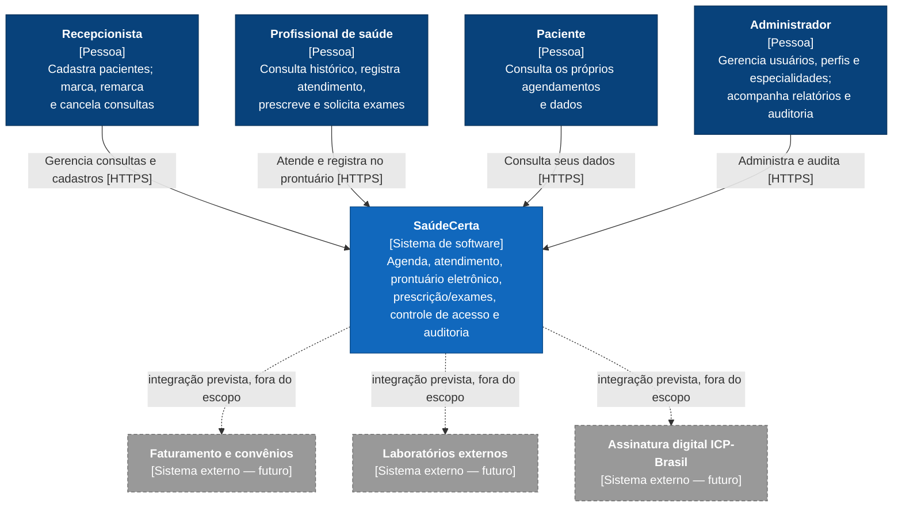
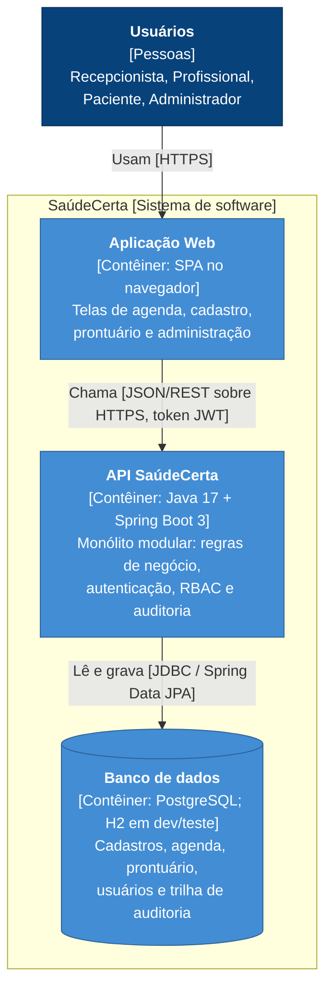
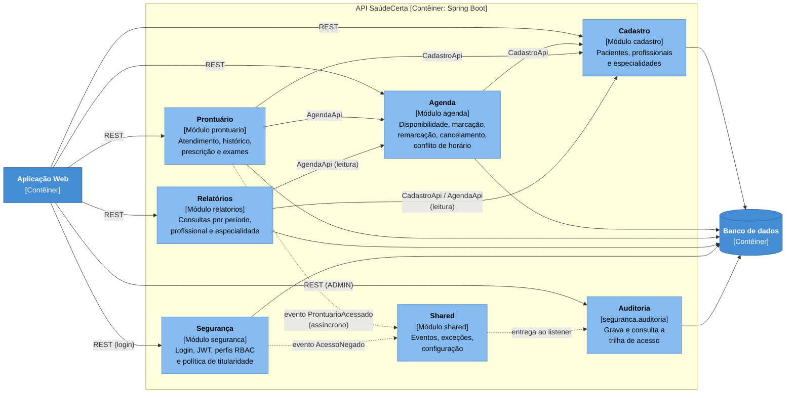
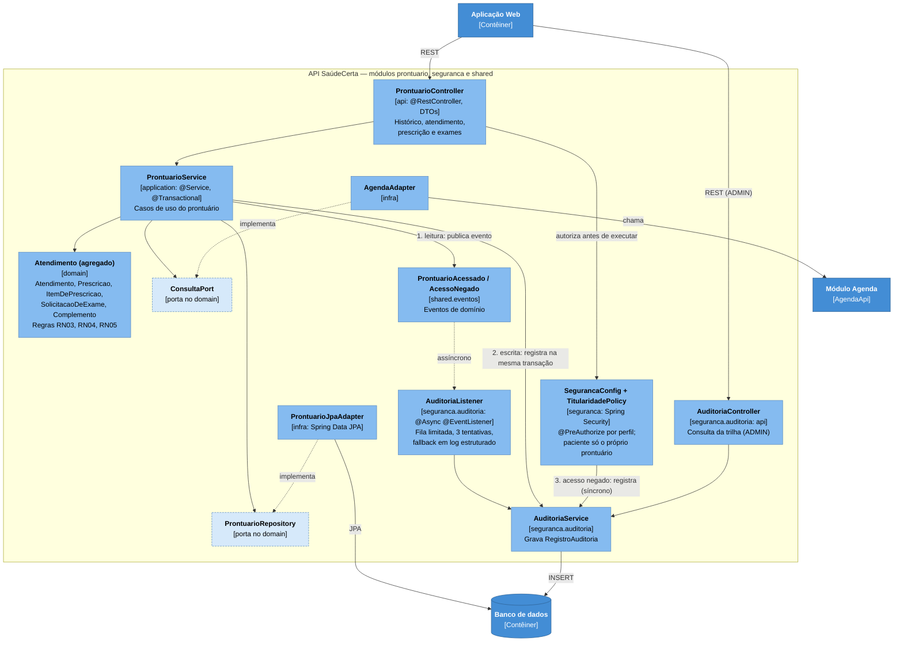
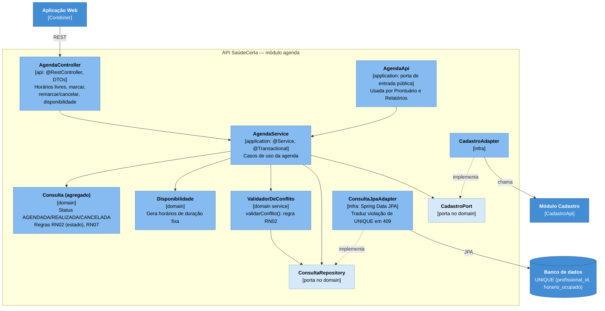
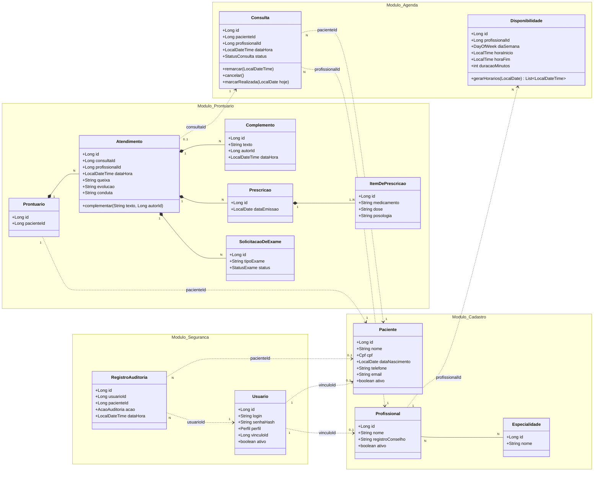

# SaúdeCerta — Projeto Arquitetural (E2)

**Disciplina:** TEADS0347 — Desenvolvimento de Aplicações Multicamadas
**Turma:** NOITE C795NL
**Docente:** Márcio Goes do Nascimento
**Período:** 2026.2
**Entrega:** E2 — Projeto Arquitetural

**Equipe:**
| Nome completo |
|---|
| Edson Davi Farias Martins |
| Marcus Carreira Júnior |
| Vergílio Junior |

**Repositório Git:** `https://github.com/Dex057/SaudeCerta`

---

## 1. Introdução e premissas

Este documento transforma os requisitos da E1 (`docs/E1-Documento-de-Visao-e-Requisitos.md`) em arquitetura. Ele contém: diagramas C4 (seção 2), camadas e componentes (seção 3), modelo de domínio (seção 4), cenários de qualidade (seção 5), seis ADRs (seção 6) e a matriz de rastreabilidade (seção 7).

A E1 deixou como ponto central a tensão entre **segurança/auditoria** (RNF01, RNF02, RNF07) e **desempenho/usabilidade** (RNF03, RNF06). Todas as decisões abaixo foram tomadas olhando para essa tensão, e cada ADR diz qual lado ela favorece e o que custa.

**Premissas assumidas pela equipe** (não vêm do guia do caso; estão aqui para ficarem explícitas e poderem ser contestadas):

- **P1 — Front-end.** A disciplina avalia a arquitetura e a API (E3). A aplicação web (SPA) aparece nos diagramas como contêiner, mas sua tecnologia não está definida e ela não é entregue no protótipo; a API será exercitada por Postman/Insomnia.
- **P2 — Volume de referência.** Para dimensionar os cenários de desempenho, assumimos até 50 mil pacientes e 500 mil consultas na base. É uma premissa a ser validada com dados sintéticos no E3.
- **P3 — Horários de duração fixa.** A agenda de um profissional é dividida em horários de duração fixa (por exemplo, 30 min), gerados a partir da disponibilidade (RF03). Assim, "mesmo horário" (RN02) significa "mesma data/hora de início".
- **P4 — Implantação simples.** Uma instância da API e um banco de dados. Alta disponibilidade com réplicas está fora do escopo (justificativa no ADR-001 e na seção 5).
- **P5 — Convenção de nomes.** Pacotes em `br.edu.ifpa.saudecerta.<módulo>.{api,application,domain,infra}`, como sugerido no guia. Os nomes de componentes usados nos diagramas, nas ADRs e na matriz são os mesmos.

---

## 2. Diagramas C4

### 2.1 Nível 1 — Contexto do sistema

Mostra o SaúdeCerta como uma caixa preta, quem o usa e o que está ao redor. Os sistemas externos tracejados **não existem hoje**: são as extensões futuras listadas como fora do escopo no guia (faturamento/convênios, laboratórios, assinatura ICP-Brasil). Ficam no diagrama para mostrar onde o sistema vai crescer (RNF05).



### 2.2 Nível 2 — Contêineres

Abre o SaúdeCerta em unidades executáveis/implantáveis. São três: a aplicação web, a API (monólito modular, ADR-001) e o banco de dados. A auditoria **não** é um contêiner separado: roda dentro da API, de forma assíncrona (ADR-002).



### 2.3 Nível 3 — Componentes da API

O contêiner **API SaúdeCerta** é dividido em módulos de negócio (pacotes de primeiro nível). Cada módulo tem as quatro camadas internas `api / application / domain / infra`.

#### 2.3.1 Visão geral dos módulos

As setas cheias são dependências de código permitidas (um módulo só usa a interface pública `*Api` do outro); as tracejadas são eventos. Segurança é transversal (autenticação e autorização por perfil valem para todos os módulos), então as setas de autorização não foram desenhadas para não poluir o diagrama. Os eventos (`ProntuarioAcessado`, `AcessoNegado`) ficam em `shared.eventos`, de modo que **nenhum módulo de negócio depende de Auditoria**.



| Componente (módulo) | Responsabilidade | Requisitos |
|---|---|---|
| Cadastro | Pacientes (CPF único), profissionais e especialidades | RF01, RF02, RN01 |
| Agenda | Disponibilidade, geração de horários, marcação/remarcação/cancelamento, anti-conflito | RF03–RF06, RN02, RN07 |
| Prontuário | Atendimento, prescrição, exames, histórico; prontuário somente-anexação | RF07–RF10, RN03–RN05 |
| Relatórios | Consultas por período/profissional/especialidade com totais | RF13 |
| Segurança | Autenticação, JWT, RBAC, titularidade (paciente só vê o próprio), hash BCrypt | RF11, RN06, RNF01, RNF07 |
| Auditoria | Registro e consulta da trilha de acesso ao prontuário | RF12, RNF02 |
| Shared | Eventos de domínio, tratamento de erros (`@ControllerAdvice`), configuração | transversal |

#### 2.3.2 Zoom: módulo Prontuário e fluxo de auditoria

É o ponto mais sensível do sistema e onde a tensão entre RNF02 e RNF03 se resolve. Três caminhos de auditoria convivem (ADR-002): **leitura** (assíncrona, via evento), **escrita** (síncrona, na mesma transação do atendimento) e **acesso negado** (síncrona).



#### 2.3.3 Zoom: módulo Agenda e o anti-conflito de horário

Concentra a dor original da clínica (dois pacientes no mesmo horário). A regra RN02 é protegida em duas linhas de defesa: validação no domínio e restrição única no banco (ADR-005).



---

## 3. Camadas e componentes

### 3.1 Camadas

Cada módulo repete as mesmas camadas (arquitetura hexagonal sobre monólito modular, conforme a E1). A **regra de dependência** é que tudo aponta para o domínio: `api → application → domain ← infra`.

| Camada | Pacote | Responsabilidade | Tecnologia (Spring) | Pode depender de |
|---|---|---|---|---|
| Apresentação | `<módulo>.api` | Expor REST, traduzir HTTP ↔ DTO, validar entrada | `@RestController`, DTOs (records), Bean Validation | `application` |
| Aplicação | `<módulo>.application` | Orquestrar casos de uso, transações, autorização por caso de uso, publicar eventos | `@Service`, `@Transactional`, `@PreAuthorize` | `domain`, `*Api` de outros módulos |
| Domínio | `<módulo>.domain` | Entidades, objetos de valor, regras RN01–RN07, portas (interfaces) | Java puro, **sem** Spring Data/JPA | nada (só `shared`) |
| Persistência | `<módulo>.infra` | Adaptadores que implementam as portas; entidades JPA e mapeadores | `@Repository`, Spring Data JPA | `domain` |
| Transversal | `seguranca`, `shared` | Autenticação, RBAC, auditoria, eventos, tratamento de erros | Spring Security, `@ControllerAdvice`, `ApplicationEventPublisher` | — |

**Regras de dependência verificáveis** (viram testes ArchUnit no E3, ver ADR-001 e ADR-003):

1. `domain` não importa `jakarta.persistence`, `org.springframework.data` nem `org.springframework.web`.
2. `api` não acessa `infra` nem `domain` diretamente (só `application`).
3. Um módulo só usa de outro módulo os tipos `*Api` e seus DTOs `*Resumo`. Exceção documentada: `relatorios` lê tabelas de outros módulos apenas para consulta (ADR-006).
4. Não há ciclos entre módulos. Direção permitida: `relatorios → agenda → cadastro` e `prontuario → agenda → cadastro`.

### 3.2 Estrutura de pacotes

```
br.edu.ifpa.saudecerta
├── cadastro      (api, application, domain, infra)   Paciente, Profissional, Especialidade
├── agenda        (api, application, domain, infra)   Consulta, Disponibilidade, ValidadorDeConflito
├── prontuario    (api, application, domain, infra)   Atendimento, Prescricao, SolicitacaoDeExame
├── relatorios    (api, application, infra)           consultas de leitura
├── seguranca     (api, application, domain, infra)   Usuario, perfis, JWT, TitularidadePolicy
│   └── auditoria (api, application, domain, infra)   RegistroAuditoria, AuditoriaListener
└── shared        (eventos, excecoes, config)         ProntuarioAcessado, AcessoNegado, @ControllerAdvice
```

### 3.3 Controle de acesso por perfil (RBAC)

Aplicado com `@PreAuthorize` na camada de aplicação (ADR-004). "Próprio" significa que o recurso pertence ao usuário logado (regra de titularidade, RN06).

| Recurso | RECEPCAO | PROFISSIONAL | PACIENTE | ADMIN |
|---|---|---|---|---|
| Pacientes (cadastro) | criar, editar, ler | ler | ler o próprio | criar, editar, ler |
| Profissionais e especialidades | ler | ler | — | criar, editar, ler |
| Disponibilidade | ler | editar a própria | — | editar |
| Consultas (marcar, remarcar, cancelar) | **sim** | ler a própria agenda | ler as próprias | ler |
| **Conteúdo clínico (prontuário)** | **negado** | ler e escrever | ler o próprio | **negado** |
| Relatórios | — | — | — | ler |
| Trilha de auditoria | — | — | — | ler |
| Usuários e perfis | — | — | — | criar, editar, ler |

Decisões de equilíbrio registradas no ADR-004: qualquer profissional pode abrir o prontuário de qualquer paciente (toda abertura é auditada), em vez de restringir a pacientes com consulta marcada com ele; o administrador não vê conteúdo clínico (menor privilégio).

### 3.4 Contrato REST resumido

Os endpoints do guia foram mantidos e completados com os necessários para cobrir todos os RFs.

| Método | Rota | Perfis | Requisito |
|---|---|---|---|
| POST | `/api/auth/login` | público | RF11 |
| POST | `/api/pacientes` | RECEPCAO, ADMIN | RF01 |
| GET | `/api/pacientes?nome=&page=&size=` | RECEPCAO, PROFISSIONAL, ADMIN | RF01, RNF03 |
| POST | `/api/profissionais` | ADMIN | RF02 |
| PUT | `/api/profissionais/{id}/disponibilidades` | PROFISSIONAL (própria), ADMIN | RF03 |
| GET | `/api/profissionais/{id}/agenda?data=` | RECEPCAO, PROFISSIONAL, ADMIN | RF03 |
| POST | `/api/consultas` | RECEPCAO | RF04, RF06 |
| PATCH | `/api/consultas/{id}` | RECEPCAO | RF05 |
| POST | `/api/consultas/{id}/atendimento` | PROFISSIONAL | RF07, RF08, RF09 |
| GET | `/api/pacientes/{id}/prontuario?page=` | PROFISSIONAL, PACIENTE (próprio) | RF10, RF12 |
| GET | `/api/relatorios/consultas?de=&ate=&profissionalId=&especialidadeId=` | ADMIN | RF13 |
| GET | `/api/auditoria?pacienteId=&usuarioId=&de=&ate=` | ADMIN | RF12, RNF02 |

Códigos de erro relevantes: `403` acesso negado (RNF01), `409` horário ocupado (RF06), `422` regra de negócio violada (RN03, RN07, RN05).

---

## 4. Modelo de domínio

O modelo parte do guia (seção 10) e foi refinado em três pontos: (1) os módulos se referenciam **só por identificador**, nunca por associação JPA entre módulos (ADR-006); (2) foi acrescentada a entidade `Complemento` para modelar o "somente-anexação" de RN05; (3) foi acrescentado `RegistroAuditoria` para RF12.



Legenda: linha cheia com losango = composição dentro do mesmo agregado; linha tracejada = referência por identificador entre agregados/módulos. Enumerações: `StatusConsulta {AGENDADA, REALIZADA, CANCELADA}`, `StatusExame {SOLICITADO, REALIZADO, CANCELADO}`, `Perfil {RECEPCAO, PROFISSIONAL, PACIENTE, ADMIN}`, `AcaoAuditoria {LEITURA, CRIACAO, COMPLEMENTO, ACESSO_NEGADO}`. `Cpf` é um objeto de valor que valida o dígito verificador.

### 4.1 Agregados

| Agregado (raiz) | Contém | Invariantes que protege |
|---|---|---|
| `Paciente` | — | RN01 (CPF único entre cadastros ativos) |
| `Profissional` | lista de `Especialidade` (referências) | RF02 (pelo menos uma especialidade) |
| `Consulta` | — | RN02 (um horário por profissional), RN07 (só cancela se AGENDADA) |
| `Atendimento` | `Complemento`, `Prescricao`, `ItemDePrescricao`, `SolicitacaoDeExame` | RN04 (nada existe sem atendimento), RN05 (imutável após criado) |
| `Usuario` | — | RNF07 (só guarda o hash) |
| `RegistroAuditoria` | — | imutável; só INSERT |

`Prontuario` é a identidade do histórico de um paciente (1:1 com `Paciente`). Para não carregar toda a história em memória, o repositório devolve os atendimentos **paginados** (`historico(pacienteId, page)`); por isso `Atendimento` é raiz do próprio agregado.

### 4.2 Onde cada regra de negócio é aplicada

| Regra | Onde é imposta | Como é testada |
|---|---|---|
| RN01 | `Cpf` + `CadastroService` consulta o repositório; índice único no banco para CPF ativo | cadastrar o mesmo CPF duas vezes → erro |
| RN02 | `ValidadorDeConflito` (domínio) + restrição `UNIQUE (profissional_id, horario_ocupado)` (ADR-005) | **teste obrigatório do E3**: dois agendamentos no mesmo horário; teste com duas threads |
| RN03 | `Consulta.marcarRealizada(hoje)` recebe a data do `Clock` injetado | consulta futura → erro 422; `Clock` fixo no teste |
| RN04 | `Prescricao` e `SolicitacaoDeExame` só são criadas por métodos do `Atendimento`; FK `NOT NULL` | impossível construir sem atendimento |
| RN05 | `Atendimento` sem setters; `ProntuarioRepository` não tem `update` nem `delete`; só `adicionarComplemento` | **teste obrigatório do E3**: não existe operação de alterar/apagar; tabela sem `DELETE` para o usuário da aplicação |
| RN06 | `@PreAuthorize` nega RECEPCAO/ADMIN no prontuário; `TitularidadePolicy` compara o paciente do token com o do recurso | teste de matriz perfil × recurso (seção 5, RNF01) |
| RN07 | `Consulta.cancelar()` lança exceção se status ≠ AGENDADA | cancelar consulta REALIZADA → 422 |

---

## 5. Cenários de qualidade

Cada cenário segue o formato do guia (fonte, estímulo, artefato, ambiente, resposta, medida) e acrescenta a tática arquitetural usada e a decisão (ADR) que a sustenta. As metas de RNF01–RNF07 vêm da E1; metas marcadas como *meta de projeto* foram definidas pela equipe para tornar o cenário verificável.

| ID | Fonte | Estímulo | Artefato | Ambiente | Resposta | Medida | Tática / ADR |
|---|---|---|---|---|---|---|---|
| **RNF01** Segurança | Usuário autenticado sem perfil clínico (ex.: recepcionista) ou paciente tentando ver prontuário alheio | `GET /api/pacientes/{id}/prontuario` | Prontuário + Segurança | Operação normal | Responde `403` sem nenhum dado clínico; grava `AcessoNegado` de forma síncrona | 100% das tentativas indevidas bloqueadas **e** registradas | RBAC, menor privilégio, titularidade — ADR-004 |
| **RNF02** Auditabilidade | Profissional | Abre o prontuário de um paciente | Prontuário + Auditoria | Operação normal | Publica `ProntuarioAcessado`; listener grava usuário, paciente, data/hora e ação | Disponível ao admin em ≤ 1 min (E1); *meta de projeto*: ≤ 5 s | Evento assíncrono, registro imutável — ADR-002 |
| **RNF03** Desempenho | Recepcionista | Busca paciente pelo nome | `GET /api/pacientes?nome=` + índice | Uso normal, base de referência da premissa P2 | Lista paginada (20 itens) a partir de índice de nome normalizado | p95 < 2 s. *Meta de projeto*: abrir o histórico (primeira página) também com p95 < 2 s | Índice, paginação, auditoria fora do caminho crítico — ADR-002, ADR-006 |
| **RNF04** Disponibilidade | Falha de processo ou de infraestrutura | A API cai durante o expediente | Contêiner da API | 12 h/dia de funcionamento | Reinício automático; `/actuator/health` indica quando voltou; auditoria pendente é drenada no desligamento ordenado | ≥ 99% por mês no período (≈ 3 h de indisponibilidade tolerada, supondo 26 dias × 12 h); implantações fora do expediente | Healthcheck, restart automático, backup diário — ADR-001 |
| **RNF05** Modificabilidade | Desenvolvedor | Incluir o módulo Faturamento | Núcleo agenda/prontuário | Evolução futura | Novo módulo usa `AgendaApi` e eventos; nenhum código de `agenda` ou `prontuario` é alterado | ≤ 5 dias de equipe; **0** arquivos alterados em `agenda.domain` e `prontuario.domain` | Módulos, portas, eventos — ADR-001, ADR-003, ADR-006 |
| **RNF06** Usabilidade | Recepcionista | Marca uma consulta simples (UC01) | Agenda + SPA | Horário de pico, telefone e balcão ao mesmo tempo | Horários livres em uma chamada; marcação atômica; conflito devolve `409` imediato com mensagem | ≤ 1 min e ≤ 5 cliques a partir da tela inicial | Endpoint de horários livres, `POST` único, sem reautenticação por ação — ADR-005, ADR-004 |
| **RNF07** Credenciais | Revisor de código ou quem tem acesso ao banco | Lê a tabela `usuario` e o código | Segurança | Qualquer | Só existe `senha_hash` (BCrypt com sal); senha nunca é gravada nem logada | 0 ocorrências de senha em texto puro no banco, código ou logs | `BCryptPasswordEncoder` — ADR-004 |

### 5.1 Pontos de tradeoff

Os pares de requisitos que se puxam em direções opostas e como a arquitetura os resolve:

| Tradeoff | Quem perde o quê | Resolução |
|---|---|---|
| **RNF02 × RNF03** — auditar tudo × leitura rápida | Auditoria síncrona penaliza a leitura; assíncrona pode perder um registro se o processo morrer | Auditoria **híbrida**: leitura assíncrona, escrita e acesso negado síncronos; risco residual declarado e com plano de evolução (outbox). ADR-002 |
| **RNF01 × RNF06** — controle forte × recepção ágil | Perfis e confirmações em excesso travam o balcão | O perfil é resolvido **uma vez**, no login (claims do JWT); a checagem por requisição é em memória, sem consulta ao banco nem confirmação extra. A restrição forte fica onde o risco está (prontuário), não na agenda. ADR-004 |
| **RNF05 × esforço** — modularidade × velocidade | Domínio puro com mapeadores dá mais classes | Aceito só nos agregados com regra; custo contido por mapeamento manual simples. ADR-003 |
| **RNF04 × custo** — disponibilidade × simplicidade | Uma instância não tem failover | A meta de 99% em horário comercial é atingível com reinício rápido; réplicas custam mais do que o requisito exige. ADR-001 |

---

## 6. Decisões arquiteturais (ADRs)

**Convenções.** Status de todas: *Aceita* (20/10/2026). Nas tabelas de custo/benefício, as notas vão de 1 (ruim) a 5 (ótimo) e, no critério de custo ou esforço, 5 significa **barato**. Os pesos (1 a 3) refletem a importância do critério para os drivers da E1. **São estimativas da equipe**, feitas antes do protótipo; devem ser revisadas no E3 com medições reais. Quando duas alternativas ficam a poucos pontos uma da outra, o texto diz isso e explica o desempate.

### ADR-001 — Monólito modular em vez de microsserviços no início

**Contexto.** A clínica tem cerca de 20 profissionais e a equipe tem 3 pessoas para um semestre. Os drivers que mais pesam aqui são entrega no prazo, RNF05 (crescer por módulos sem reescrita) e RNF04 (99% no expediente). O Projeto Final exige extrair pelo menos um serviço do monólito.

**Decisão.** Um único artefato implantável (a API), dividido em módulos de negócio com fronteiras explícitas: `cadastro`, `agenda`, `prontuario`, `relatorios`, `seguranca`. Módulos só se falam por interfaces `*Api` ou por eventos. As regras são verificadas por testes ArchUnit.

**Alternativas consideradas.**

- **A. Monólito modular** (escolhida).
- **B. Microsserviços desde o início.** Fronteiras e escala independentes, mas exigem rede entre serviços, deploy e observabilidade por serviço e consistência distribuída (marcar consulta + validar paciente viram chamadas remotas).
- **C. Monólito sem modularização.** O mais rápido de começar; mas o acoplamento cresce sem controle e a extração do PF vira reescrita.

| Critério (peso) | A. Monólito modular | B. Microsserviços | C. Monólito simples |
|---|---|---|---|
| Simplicidade de implantação e operação (3) | 4 | 1 | 5 |
| Velocidade de entrega no semestre (3) | 4 | 2 | 5 |
| Modificabilidade / extração futura — RNF05 (3) | 4 | 5 | 1 |
| Disponibilidade com recursos mínimos — RNF04 (1) | 4 | 2 | 4 |
| Isolamento de falhas e escala independente (1) | 2 | 5 | 2 |
| **Total ponderado** | **42** | **31** | **39** |

**Consequências.**
(+) Um único deploy e uma única transação cobrindo marcação + validação; fronteiras claras preparam a extração no PF.
(+) Custo de infraestrutura mínimo, compatível com a meta de RNF04.
(−) Uma falha derruba todos os módulos (sem isolamento); aceitável para a escala da clínica.
(−) Exige disciplina: sem ArchUnit, um `import` indevido desfaz a modularidade. **Mitigação:** testes de arquitetura rodando no build.
**Quando reavaliar:** se um módulo precisar escalar sozinho ou ter ciclo de deploy próprio (candidatos: Prontuário, Agenda).

**Rastreia:** RNF04, RNF05, E1 §9.

---

### ADR-002 — Auditoria de acesso ao prontuário híbrida: assíncrona na leitura, síncrona na escrita

**Contexto.** RF12/RNF02 exigem registrar todo acesso ao prontuário; RNF03 exige leitura rápida. Há três situações diferentes: (1) **leitura**, a mais frequente; (2) **escrita** (atendimento, prescrição, exame), rara e já transacional; (3) **acesso negado**, rara e a mais importante para segurança. A meta de RNF02 é "disponível em até 1 minuto", o que já admite uma pequena defasagem. Um fato que a análise precisa admitir: com ~20 profissionais e um único banco, um `INSERT` síncrono por leitura custa poucos milissegundos, então o ganho de desempenho isolado é modesto. O argumento forte é outro: no Projeto Final o Prontuário pode virar um serviço separado, e aí a auditoria síncrona vira uma chamada remota no caminho crítico da leitura.

**Decisão.**

- **Leitura:** o `ProntuarioService` publica o evento `ProntuarioAcessado`; o `AuditoriaListener` (`@Async`, fila limitada com política *caller-runs*, para nunca descartar evento por estouro de fila) grava o `RegistroAuditoria`. Falha na gravação: 3 tentativas e, se persistir, registro em log estruturado `AUDITORIA_FALHA` com alerta. No desligamento, a fila é drenada (*graceful shutdown*).
- **Escrita:** o `RegistroAuditoria` é gravado **na mesma transação** da alteração. Não existe alteração sem rastro.
- **Acesso negado:** gravado de forma síncrona (`AcessoNegado`).
- **Política de falha:** a leitura segue (*fail-open*) mesmo se a auditoria falhar. Bloquear um profissional que precisa do histórico durante um atendimento é pior do que registrar com atraso; o risco é aceito e monitorado.

**Alternativas consideradas.**

- **A. Híbrida** (escolhida).
- **B. Tudo síncrono** na mesma transação: garantia máxima e implementação trivial, mas acopla Auditoria a cada caso de uso, põe um `INSERT` em toda leitura e inviabiliza a extração do PF sem transação distribuída.
- **C. Tudo assíncrono**, inclusive escrita: mais simples de uniformizar, mas pode perder o registro de uma alteração clínica numa queda de processo.
- **D. Outbox transacional:** o evento é gravado numa tabela na mesma transação e um processo o encaminha à auditoria. Garante não perder registro e prepara o PF, mas exige tabela, relay, reprocessamento e idempotência, e transforma a leitura em transação de escrita.

| Critério (peso) | A. Híbrida | B. Síncrona | C. Toda assíncrona | D. Outbox |
|---|---|---|---|---|
| Desempenho de leitura — RNF03 (2) | 4 | 3 | 4 | 3 |
| Garantia de não perder registro — RNF01/02 (3) | 3 | 5 | 2 | 5 |
| Simplicidade e prazo (3) | 4 | 5 | 4 | 2 |
| Desacoplamento e extração futura (3) | 4 | 2 | 4 | 5 |
| Isolamento: falha na auditoria não bloqueia o atendimento (2) | 4 | 1 | 4 | 3 |
| **Total ponderado** | **49** | **44** | **46** | **48** |

A diferença entre A e D é de 1 ponto, dentro da margem de erro da estimativa. O desempate é o prazo e a experiência da equipe (peso de simplicidade); D fica registrado como evolução natural.

**Consequências.**
(+) Leitura não espera a gravação da auditoria; Auditoria não é conhecida pelos módulos de negócio (só pelos eventos em `shared`).
(+) Escritas e tentativas negadas têm garantia forte.
(−) **Risco residual:** um evento de leitura em memória pode se perder se o processo for morto sem desligamento ordenado (janela de segundos). Mitigação: log estruturado de acesso HTTP (usuário + rota) como evidência redundante e independente.
(−) Duas rotas de gravação para manter e testar.
**Quando reavaliar (gatilho para migrar para D):** exigência regulatória de zero perda de registro de leitura, ou extração do Prontuário como serviço.

**Rastreia:** RF12, RF10, RF07, RNF01, RNF02, RNF03.

---

### ADR-003 — Domínio isolado da infraestrutura por portas (hexagonal)

**Contexto.** O guia lista como erros comuns o domínio anêmico, o vazamento de JPA no domínio e o controller gordo. As regras RN01–RN07 são o coração do sistema e precisam ser testáveis sem banco. A E1 já adotou o estilo hexagonal; este ADR registra o custo real dessa escolha.

**Decisão.** O domínio é composto de classes Java puras, com comportamento (`Consulta.cancelar()`, `Atendimento.complementar()`), sem anotações de Spring Data/JPA. O domínio declara **portas** (`ConsultaRepository`, `ProntuarioRepository`, `CadastroPort`, `ConsultaPort`); a camada `infra` as implementa com adaptadores JPA, com entidades JPA próprias e **mapeamento manual** entre elas.

**Alternativas consideradas.**

- **A. Domínio puro + portas + adaptadores JPA** (escolhida).
- **B. Camadas clássicas com entidades JPA como domínio:** `Controller → Service → Repository` Spring Data; as entidades carregam anotações e regras.
- **C. Domínio anêmico** (entidades só com getters/setters, regra no `Service`): o mais rápido, mas é o erro nº 1 da lista do guia.

| Critério (peso) | A. Hexagonal | B. JPA como domínio | C. Anêmico |
|---|---|---|---|
| Testabilidade das regras sem banco (3) | 5 | 3 | 2 |
| Modificabilidade e extração futura — RNF05 (3) | 5 | 2 | 1 |
| Esforço de implementação (2) | 2 | 4 | 5 |
| Curva de aprendizado da equipe (1) | 2 | 4 | 5 |
| **Total ponderado** | **36** | **27** | **24** |

**Consequências.**
(+) Regras RN02 e RN05 testadas com testes unitários puros, rápidos, exigidos no E3.
(+) Trocar a persistência ou extrair um serviço não mexe no domínio.
(−) **Custo:** para cada agregado, uma entidade JPA e um mapeador a mais; mais classes e risco de mapeamento esquecido. **Mitigação:** mapeamento manual simples (sem biblioteca extra), testes de mapeamento de ida e volta nos agregados com regra.
(−) Fere o "mínimo de código"; só se paga porque RNF05 e o PF exigem a fronteira.
**Quando reavaliar:** se algum módulo for só CRUD sem regra (hoje, `Especialidade`), aceitar entidade JPA direta como exceção documentada.

**Rastreia:** RF02, RF07, RF08, RF09, RN01–RN07, RNF05.

---

### ADR-004 — Controle de acesso por perfil (RBAC) com regra de titularidade, e JWT de curta duração

**Contexto.** RF11 exige acesso por perfil (4 perfis); RN06 exige que paciente só veja os próprios dados e que a recepção não veja conteúdo clínico. Isso é mais do que RBAC puro: "só o próprio" depende do recurso. Ao mesmo tempo, a recepção no horário de pico (RNF06) não pode sofrer passos extras de segurança.

**Decisão.**

1. **Modelo:** RBAC com quatro perfis, aplicado com `@PreAuthorize` na camada de aplicação, mais uma `TitularidadePolicy` que compara o paciente do token com o do recurso (RN06).
2. **Menor privilégio:** recepção e administrador não acessam conteúdo clínico. **Equilíbrio:** qualquer profissional pode abrir qualquer prontuário (a equipe é pequena e pode precisar cobrir colegas), mas **toda** abertura é auditada (ADR-002). Restringir a pacientes com consulta marcada fica como endurecimento futuro.
3. **Sessão:** autenticação *stateless* com JWT de curta duração; perfil e id do vínculo vão nas *claims*. Senha com BCrypt (RNF07). Nenhuma reconfirmação por ação.

**Alternativas consideradas (modelo de autorização).**

- **A. RBAC + titularidade** (escolhida).
- **B. ABAC / motor de políticas externo** (ex.: OPA): regras muito flexíveis (horário, vínculo, finalidade), mas é infraestrutura nova para operar.
- **C. ACL por registro** (Spring ACL): permissão por prontuário, granularidade máxima, porém consulta ao banco a cada acesso e gestão trabalhosa.

**Alternativas consideradas (sessão).**

- **JWT curto** (escolhida): sem estado no servidor, trafega entre serviços no PF. Custo: um token válido não pode ser revogado antes de expirar. Mitigação: expiração curta (ordem de 15 a 30 min) e renovação por *refresh token* guardado no servidor, que pode ser revogado (o refresh fica para o PF; o E3 usa só o token de acesso).
- **Sessão no servidor (cookie HttpOnly):** revogação imediata e menos exposição a roubo de token por script; porém exige estado compartilhado quando houver mais de um serviço.

| Critério (peso) | A. RBAC + titularidade | B. ABAC / OPA | C. ACL por registro |
|---|---|---|---|
| Segurança e granularidade (3) | 3 | 5 | 4 |
| Impacto em latência e usabilidade — RNF03/06 (2) | 5 | 4 | 3 |
| Simplicidade e prazo (3) | 5 | 1 | 2 |
| Aderência a RN06 (2) | 4 | 5 | 4 |
| **Total ponderado** | **42** | **36** | **32** |

**Consequências.**
(+) Checagem em memória: não acrescenta consulta ao banco nem passo para a recepção (resolve RNF01 × RNF06 sem sacrificar o prontuário).
(+) Spring Security já faz o essencial; a política de titularidade é uma classe pequena.
(−) Granularidade limitada: dois profissionais veem os mesmos prontuários; só a auditoria dissuade abuso. Risco aceito e declarado.
(−) Revogação de acesso (ex.: funcionário desligado) só vale após a expiração do token. Mitigação: expiração curta e `Usuario.ativo` conferido no refresh.
**Quando reavaliar:** quando a clínica crescer em número de profissionais, ou por exigência de segregação por especialidade.

**Rastreia:** RF11, RN06, RNF01, RNF06, RNF07.

---

### ADR-005 — Conflito de horário: validação no domínio mais restrição única no banco

**Contexto.** Este é o problema que originou o projeto: a planilha permitiu o mesmo profissional com dois pacientes no mesmo horário porque duas pessoas escreviam ao mesmo tempo. Uma validação só na aplicação (ler "o horário está livre?" e depois gravar) tem uma janela de corrida: dois pedidos simultâneos leem "livre" e ambos gravam. RN02 só vale para consultas **AGENDADA**: uma consulta cancelada libera o horário (RF05). Pela premissa P3, "mesmo horário" é a mesma data/hora de início.

**Decisão.** Duas linhas de defesa:

1. **Domínio:** `ValidadorDeConflito.validarConflito()` consulta a porta `ConsultaRepository` antes de agendar e devolve erro de negócio com mensagem clara (caminho comum, sem custo de exceção de banco).
2. **Banco:** restrição `UNIQUE (profissional_id, horario_ocupado)`, onde `horario_ocupado` é igual a `data_hora` quando o status é AGENDADA e `NULL` caso contrário. Como `NULL` não colide em restrição única, consultas canceladas ou realizadas não bloqueiam o horário, e a técnica funciona igual em PostgreSQL e H2. O `ConsultaJpaAdapter` traduz a violação em `409 Conflict`.

**Alternativas consideradas.**

- **A. Domínio + UNIQUE no banco** (escolhida).
- **B. Só validação na aplicação** (verifica e depois grava): simples e com boa mensagem, mas **não** impede a corrida, que é exatamente o defeito a corrigir.
- **C. Lock pessimista** (`SELECT ... FOR UPDATE` na linha do profissional ou da agenda): correto, porém serializa todas as marcações do profissional e acrescenta transação mais longa.
- **D. Lock otimista** (`@Version`): marcar é um *insert*, não há linha existente para versionar; seria preciso criar uma linha-pai artificial só para isso.

| Critério (peso) | A. Domínio + UNIQUE | B. Só aplicação | C. Lock pessimista | D. Lock otimista |
|---|---|---|---|---|
| Correção sob concorrência (3) | 5 | 1 | 4 | 4 |
| Simplicidade (2) | 4 | 5 | 3 | 3 |
| Desempenho e contenção (1) | 5 | 5 | 3 | 4 |
| Mensagem de erro amigável — RNF06 (2) | 4 | 5 | 4 | 3 |
| Portabilidade H2 / PostgreSQL (1) | 4 | 5 | 4 | 4 |
| **Total ponderado** | **40** | **33** | **33** | **32** |

**Consequências.**
(+) A garantia é do banco: mesmo um bug futuro na aplicação não gera duplicidade.
(+) O caminho comum devolve mensagem amigável imediata, o que ajuda a recepção (RNF06).
(−) A regra existe em dois lugares (domínio e esquema); precisam andar juntas. **Mitigação:** um único teste de concorrência com duas threads exercita os dois (um `201`, um `409`).
(−) A coluna `horario_ocupado` é derivada; o mapeador precisa preenchê-la ao mudar o status.
**Limite conhecido:** funciona com horários de duração fixa (P3). Se um dia houver consultas de duração variável, trocar por restrição de exclusão de intervalos do PostgreSQL (`EXCLUDE USING gist`).

**Rastreia:** RF04, RF05, RF06, RN02, RNF06.

---

### ADR-006 — Banco relacional único com propriedade de tabelas por módulo

**Contexto.** RNF05 e o PF pedem que um módulo possa ser extraído. Se vários módulos fizerem `JOIN` e `FOREIGN KEY` livremente entre tabelas, extrair um deles significa desembaraçar o banco. Por outro lado, um banco por módulo agora seria custo operacional sem retorno para uma clínica de 20 profissionais. O guia sugere H2 em desenvolvimento e PostgreSQL opcional.

**Decisão.**

- **PostgreSQL** em produção; **H2** em desenvolvimento e testes (premissa: as diferenças são contidas, por isso o ADR-005 usa a técnica de `NULL` em vez de índice parcial, que o H2 não tem).
- **Um banco**, mas cada tabela pertence a **um** módulo (prefixo ou *schema* por módulo). Nenhum módulo acessa tabela de outro: usa a `*Api` do dono.
- Referências entre módulos são só por identificador (`paciente_id`), **sem FK física entre módulos**. O risco de referência solta é baixo porque o sistema nunca exclui paciente ou profissional, apenas os inativa (RN01 fala em "cadastro ativo").
- **Exceção explícita:** `relatorios` pode ler tabelas de outros módulos, somente leitura e por consultas dedicadas, porque seus totais cruzam agenda, profissional e especialidade (RF13). Fica registrada e restrita no ArchUnit.
- Índices: CPF único entre ativos (RN01), nome de paciente normalizado (minúsculas, sem acento) para busca por prefixo, `consulta (profissional_id, data_hora)`, `registro_auditoria (paciente_id, data_hora)`. Em produção, o usuário do banco da aplicação **não** tem `UPDATE`/`DELETE` em `registro_auditoria` nem em `atendimento` (reforço de RN05 e da imutabilidade da trilha).

**Alternativas consideradas.**

- **A. Banco único com propriedade por módulo** (escolhida).
- **B. Banco único sem restrições** (`JOIN` e FK livres): o mais simples e com a melhor integridade referencial, mas deixa o acoplamento de dados escondido e dificulta a extração.
- **C. Um banco por módulo desde já:** isolamento total, mas custo operacional alto, sem transação entre módulos e relatórios que viram composição de serviços.

| Critério (peso) | A. Único com propriedade | B. Único livre | C. Banco por módulo |
|---|---|---|---|
| Extração futura — RNF05 / PF (3) | 4 | 1 | 5 |
| Integridade referencial (2) | 3 | 5 | 1 |
| Custo operacional (2) | 4 | 5 | 1 |
| Desempenho de consultas e relatórios — RNF03 (2) | 4 | 5 | 2 |
| **Total ponderado** | **34** | **33** | **23** |

A e B ficam a 1 ponto. B vence em três critérios (integridade, custo e desempenho) e só perde onde o projeto mais precisa (extração, exigida no PF); por isso a nota ponderada não deve ser lida como diferença real, e sim como "A custa um pouco mais e compra o que o PF exige".

**Consequências.**
(+) Extrair um serviço significa mover tabelas já isoladas, não separar um emaranhado.
(+) A auditoria e o prontuário ficam protegidos contra alteração por privilégio do banco, além do código.
(−) Sem FK entre módulos, a integridade depende da aplicação e da regra de inativar em vez de excluir.
(−) O módulo Relatórios é uma exceção que precisará ser trocada por composição de APIs ou modelo de leitura replicado se Agenda ou Cadastro forem extraídos.
(−) Desenvolver em H2 e rodar em PostgreSQL pode esconder diferenças. **Mitigação:** rodar a suíte de integração também contra PostgreSQL (contêiner) antes das entregas.

**Rastreia:** RF01, RF13, RN01, RN05, RNF03, RNF05.

---

## 7. Matriz de rastreabilidade

Liga cada requisito à decisão que o sustenta, ao componente/tática que o implementa e à forma de verificar. Os nomes de componentes são os mesmos dos diagramas da seção 2. Os testes listados são os **planejados** para o E3 e o Projeto Final.

| Requisito | Decisão (ADR) | Componente / tática | Como verificar |
|---|---|---|---|
| **RF01** Cadastrar pacientes | ADR-003, ADR-006 | `CadastroController` → `CadastroService` → `Paciente` + `Cpf`; porta `PacienteRepository`; índice único de CPF ativo | Cadastro válido aparece na busca; CPF repetido é rejeitado (RN01) |
| **RF02** Cadastrar profissionais e especialidades | ADR-003 | `Profissional` exige ao menos uma `Especialidade` | Teste unitário: salvar sem especialidade lança exceção |
| **RF03** Definir agenda do profissional | ADR-003 | `Disponibilidade.gerarHorarios()`; `AgendaController` (`GET .../agenda`) | Faixa 08:00–12:00 com 30 min gera 8 horários |
| **RF04** Marcar consulta | ADR-005 | `AgendaService`, `Consulta` (status AGENDADA) | `POST /api/consultas` devolve `201` e `AGENDADA` |
| **RF05** Remarcar/cancelar | ADR-005 | `Consulta.remarcar()` / `cancelar()`; `horario_ocupado = NULL` libera o horário | Cancelar e marcar de novo o mesmo horário funciona |
| **RF06** Impedir conflito | ADR-005 | `ValidadorDeConflito.validarConflito()` + `UNIQUE (profissional_id, horario_ocupado)` | Teste unitário com dois agendamentos no mesmo horário; teste com duas threads (um `201`, um `409`) |
| **RF07** Registrar atendimento | ADR-003, ADR-002 | `ProntuarioService`, `Atendimento` imutável; auditoria de escrita na mesma transação | Atendimento salvo; tentativa de alterar/apagar não tem operação (RN05) |
| **RF08** Emitir prescrição | ADR-003 | `Prescricao` / `ItemDePrescricao` dentro do `Atendimento` | Prescrição sem atendimento é impossível (RN04); exige ≥ 1 item |
| **RF09** Solicitar exames | ADR-003 | `SolicitacaoDeExame` dentro do `Atendimento` | Exame sem atendimento é impossível (RN04); status inicial SOLICITADO |
| **RF10** Consultar histórico | ADR-002, ADR-004 | `ProntuarioService.consultarHistorico` paginado; porta `ProntuarioRepository` | Ordem cronológica; p95 < 2 s na primeira página |
| **RF11** Autenticar e aplicar perfis | ADR-004 | `SegurancaConfig`, `AuthController`, filtro JWT, `@PreAuthorize` | Teste da matriz perfil × recurso (seção 3.3) |
| **RF12** Auditar acesso ao prontuário | ADR-002 | `AuditoriaListener`, `AuditoriaService`, `RegistroAuditoria`, `AuditoriaController` | Acessar prontuário e verificar o registro (com espera assíncrona) |
| **RF13** Gerar relatórios | ADR-006 | `RelatoriosService` com consultas de leitura dedicadas | Totais corretos sobre massa de dados conhecida |
| **RNF01** Segurança/Privacidade | ADR-004, ADR-002 | RBAC, `TitularidadePolicy`, `AcessoNegado` síncrono | Teste: todo perfil sem permissão recebe `403` e gera registro de negado; 100% da matriz |
| **RNF02** Auditabilidade | ADR-002 | Evento `ProntuarioAcessado` + listener assíncrono; trilha imutável | Registro visível ao admin em ≤ 1 min (meta de projeto: 5 s) |
| **RNF03** Desempenho | ADR-002, ADR-006 | Índice de nome, paginação, auditoria fora do caminho crítico | Medição de p95 da busca com 50 mil pacientes sintéticos (premissa P2) |
| **RNF04** Disponibilidade | ADR-001 | Monólito com `/actuator/health`, reinício automático, backup diário | Derrubar o processo e medir o tempo de recuperação; fila de auditoria drenada no desligamento |
| **RNF05** Modificabilidade | ADR-001, ADR-003, ADR-006 | Módulos, portas `*Api`, eventos em `shared`, tabelas por módulo | Testes ArchUnit; exercício: módulo `faturamento` vazio sem alterar `agenda`/`prontuario` |
| **RNF06** Usabilidade | ADR-005, ADR-004 | `GET .../agenda` (horários livres), `POST /api/consultas` atômico, `409` imediato, sem reconfirmação | Roteiro cronometrado do UC01: ≤ 1 min e ≤ 5 cliques |
| **RNF07** Segurança de credenciais | ADR-004 | `BCryptPasswordEncoder`; `Usuario.senhaHash` | Teste: valor gravado começa com `$2`; revisão de código sem senha em texto |

### 7.1 Cobertura inversa (ADR → requisitos)

Confere que nenhuma decisão ficou sem requisito e nenhum RNF ficou sem decisão.

| ADR | Requisitos que sustenta |
|---|---|
| ADR-001 Monólito modular | RNF04, RNF05 |
| ADR-002 Auditoria híbrida | RF07, RF10, RF12, RNF01, RNF02, RNF03 |
| ADR-003 Hexagonal | RF01, RF02, RF03, RF07, RF08, RF09, RNF05 |
| ADR-004 RBAC + titularidade + JWT | RF10, RF11, RN06, RNF01, RNF06, RNF07 |
| ADR-005 Anti-conflito de horário | RF04, RF05, RF06, RN02, RNF06 |
| ADR-006 Banco com propriedade por módulo | RF01, RF13, RN05, RNF03, RNF05 |

Os requisitos RNF01 a RNF07 aparecem cada um em pelo menos uma ADR; os RF01 a RF13 também. As regras de negócio RN01–RN07 têm seu local de aplicação e teste na seção 4.2.

---

## 8. Pontos em aberto

- **Front-end (P1):** tecnologia e implantação da SPA ainda não definidas.
- **Volumes (P2):** a base de referência é uma suposição; validar com dados sintéticos no E3.
- **Auditoria (ADR-002):** o risco residual da leitura assíncrona é aceito; reavaliar se houver exigência de zero perda.
- **Refresh token (ADR-004):** fica para o Projeto Final; o protótipo usa só o token de acesso.
- **Projeto Final:** o primeiro candidato à extração é o Prontuário (auditoria já desacoplada por eventos) ou a Agenda (ADR-005 e a porta `CadastroPort` já isolam a dependência). A escolha e o novo diagrama de contêineres ficam para aquela entrega.
