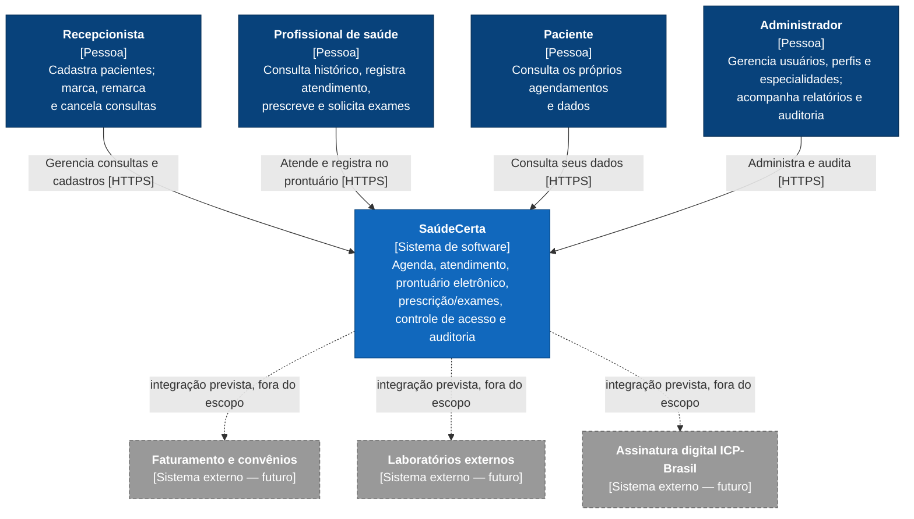
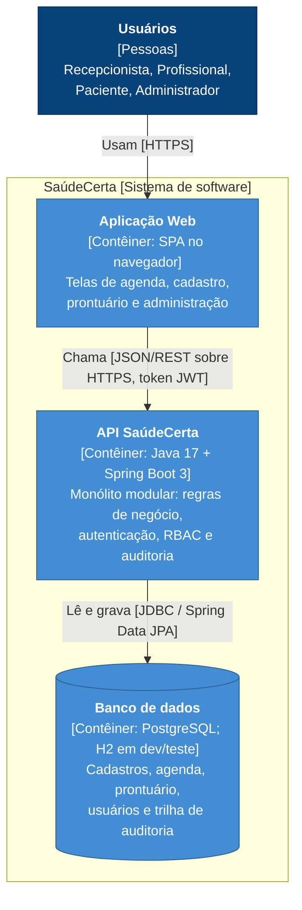
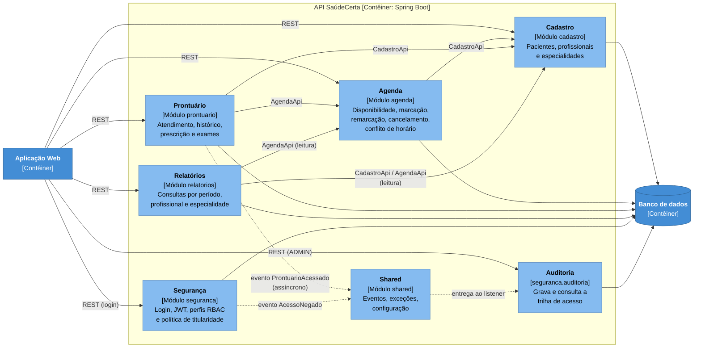
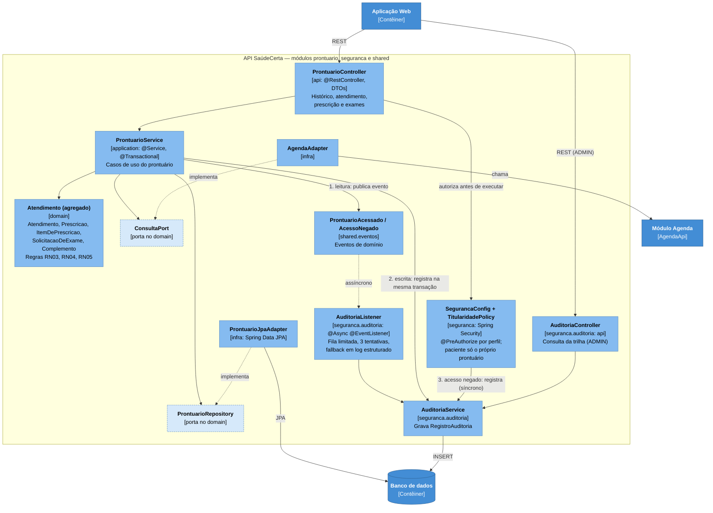
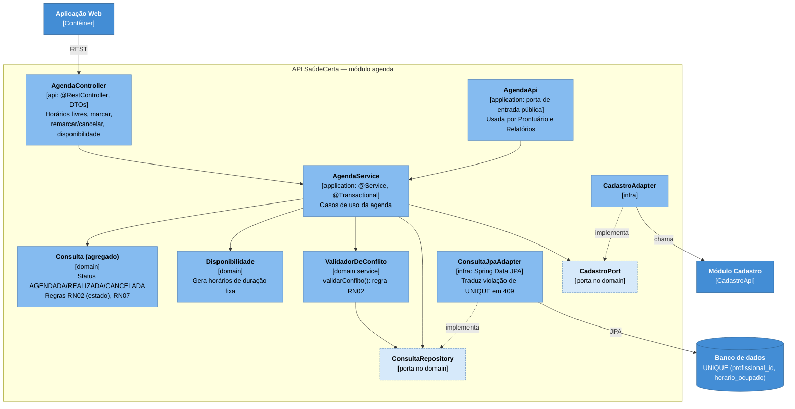
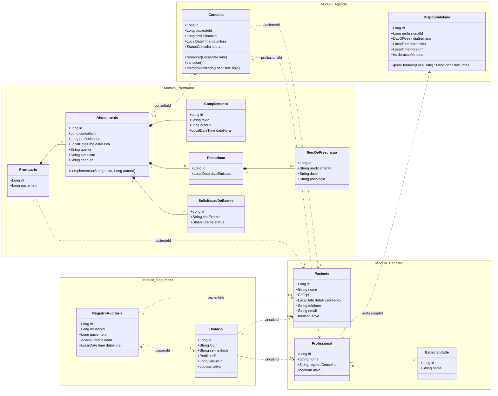

# SaúdeCerta — Projeto Arquitetural (E2)

**Disciplina:** TEADS0347 — Desenvolvimento de Aplicações Multicamadas
**Turma:** NOITE C795NL
**Docente:** Márcio Goes do Nascimento
**Período:** 2026.2
**Entrega:** E2 — Projeto Arquitetural

**Equipe:**
| Nome completo |
|---|
| Edson Davi Farias Martins |
| Marcus Carreira Júnior |
| Vergílio Junior |

**Repositório Git:** `https://github.com/Dex057/equipe-02-saudecerta`

---

## 1. Introdução e premissas

Este documento transforma os requisitos da E1 ([`visao.md`](visao.md) e [`requisitos.md`](requisitos.md)) em arquitetura. Ele contém: diagramas C4 (seção 2), camadas e componentes (seção 3), modelo de domínio (seção 4) e cenários de qualidade (seção 5). As decisões estão em [`adr/`](adr/README.md) e a matriz de rastreabilidade em [`rastreabilidade.md`](rastreabilidade.md).

A E1 deixou como ponto central a tensão entre **segurança/auditoria** (RNF01, RNF02, RNF07) e **desempenho/usabilidade** (RNF03, RNF06). Todas as decisões abaixo foram tomadas olhando para essa tensão, e cada ADR diz qual lado ela favorece e o que custa.

**Premissas assumidas pela equipe** (não vêm do guia do caso; estão aqui para ficarem explícitas e poderem ser contestadas):

- **P1 — Front-end.** A disciplina avalia a arquitetura e a API (E3). A aplicação web (SPA) aparece nos diagramas como contêiner, mas sua tecnologia não está definida e ela não é entregue no protótipo; a API será exercitada por Postman/Insomnia.
- **P2 — Volume de referência.** Para dimensionar os cenários de desempenho, assumimos até 50 mil pacientes e 500 mil consultas na base. É uma premissa a ser validada com dados sintéticos no E3.
- **P3 — Horários de duração fixa.** A agenda de um profissional é dividida em horários de duração fixa (por exemplo, 30 min), gerados a partir da disponibilidade (RF03). Assim, "mesmo horário" (RN02) significa "mesma data/hora de início".
- **P4 — Implantação simples.** Uma instância da API e um banco de dados. Alta disponibilidade com réplicas está fora do escopo (justificativa no ADR-001 e na seção 5).
- **P5 — Convenção de nomes.** Pacotes em `br.edu.ifpa.saudecerta.<módulo>.{api,application,domain,infra}`, como sugerido no guia. Os nomes de componentes usados nos diagramas, nas ADRs e na matriz são os mesmos.

---

## 2. Diagramas C4

### 2.1 Nível 1 — Contexto do sistema

Mostra o SaúdeCerta como uma caixa preta, quem o usa e o que está ao redor. Os sistemas externos tracejados **não existem hoje**: são as extensões futuras listadas como fora do escopo no guia (faturamento/convênios, laboratórios, assinatura ICP-Brasil). Ficam no diagrama para mostrar onde o sistema vai crescer (RNF05).



### 2.2 Nível 2 — Contêineres

Abre o SaúdeCerta em unidades executáveis/implantáveis. São três: a aplicação web, a API (monólito modular, ADR-001) e o banco de dados. A auditoria **não** é um contêiner separado: roda dentro da API, de forma assíncrona (ADR-002).



### 2.3 Nível 3 — Componentes da API

O contêiner **API SaúdeCerta** é dividido em módulos de negócio (pacotes de primeiro nível). Cada módulo tem as quatro camadas internas `api / application / domain / infra`.

#### 2.3.1 Visão geral dos módulos

As setas cheias são dependências de código permitidas (um módulo só usa a interface pública `*Api` do outro); as tracejadas são eventos. Segurança é transversal (autenticação e autorização por perfil valem para todos os módulos), então as setas de autorização não foram desenhadas para não poluir o diagrama. Os eventos (`ProntuarioAcessado`, `AcessoNegado`) ficam em `shared.eventos`, de modo que **nenhum módulo de negócio depende de Auditoria**.



| Componente (módulo) | Responsabilidade | Requisitos |
|---|---|---|
| Cadastro | Pacientes (CPF único), profissionais e especialidades | RF01, RF02, RN01 |
| Agenda | Disponibilidade, geração de horários, marcação/remarcação/cancelamento, anti-conflito | RF03–RF06, RN02, RN07 |
| Prontuário | Atendimento, prescrição, exames, histórico; prontuário somente-anexação | RF07–RF10, RN03–RN05 |
| Relatórios | Consultas por período/profissional/especialidade com totais | RF13 |
| Segurança | Autenticação, JWT, RBAC, titularidade (paciente só vê o próprio), hash BCrypt | RF11, RN06, RNF01, RNF07 |
| Auditoria | Registro e consulta da trilha de acesso ao prontuário | RF12, RNF02 |
| Shared | Eventos de domínio, tratamento de erros (`@ControllerAdvice`), configuração | transversal |

#### 2.3.2 Zoom: módulo Prontuário e fluxo de auditoria

É o ponto mais sensível do sistema e onde a tensão entre RNF02 e RNF03 se resolve. Três caminhos de auditoria convivem (ADR-002): **leitura** (assíncrona, via evento), **escrita** (síncrona, na mesma transação do atendimento) e **acesso negado** (síncrona).



#### 2.3.3 Zoom: módulo Agenda e o anti-conflito de horário

Concentra a dor original da clínica (dois pacientes no mesmo horário). A regra RN02 é protegida em duas linhas de defesa: validação no domínio e restrição única no banco (ADR-005).



---

## 3. Camadas e componentes

### 3.1 Camadas

Cada módulo repete as mesmas camadas (arquitetura hexagonal sobre monólito modular, conforme a E1). A **regra de dependência** é que tudo aponta para o domínio: `api → application → domain ← infra`.

| Camada | Pacote | Responsabilidade | Tecnologia (Spring) | Pode depender de |
|---|---|---|---|---|
| Apresentação | `<módulo>.api` | Expor REST, traduzir HTTP ↔ DTO, validar entrada | `@RestController`, DTOs (records), Bean Validation | `application` |
| Aplicação | `<módulo>.application` | Orquestrar casos de uso, transações, autorização por caso de uso, publicar eventos | `@Service`, `@Transactional`, `@PreAuthorize` | `domain`, `*Api` de outros módulos |
| Domínio | `<módulo>.domain` | Entidades, objetos de valor, regras RN01–RN07, portas (interfaces) | Java puro, **sem** Spring Data/JPA | nada (só `shared`) |
| Persistência | `<módulo>.infra` | Adaptadores que implementam as portas; entidades JPA e mapeadores | `@Repository`, Spring Data JPA | `domain` |
| Transversal | `seguranca`, `shared` | Autenticação, RBAC, auditoria, eventos, tratamento de erros | Spring Security, `@ControllerAdvice`, `ApplicationEventPublisher` | — |

**Regras de dependência verificáveis** (viram testes ArchUnit no E3, ver ADR-001 e ADR-003):

1. `domain` não importa `jakarta.persistence`, `org.springframework.data` nem `org.springframework.web`.
2. `api` não acessa `infra` nem `domain` diretamente (só `application`).
3. Um módulo só usa de outro módulo os tipos `*Api` e seus DTOs `*Resumo`. Exceção documentada: `relatorios` lê tabelas de outros módulos apenas para consulta (ADR-006).
4. Não há ciclos entre módulos. Direção permitida: `relatorios → agenda → cadastro` e `prontuario → agenda → cadastro`.

### 3.2 Estrutura de pacotes

```
br.edu.ifpa.saudecerta
├── cadastro      (api, application, domain, infra)   Paciente, Profissional, Especialidade
├── agenda        (api, application, domain, infra)   Consulta, Disponibilidade, ValidadorDeConflito
├── prontuario    (api, application, domain, infra)   Atendimento, Prescricao, SolicitacaoDeExame
├── relatorios    (api, application, infra)           consultas de leitura
├── seguranca     (api, application, domain, infra)   Usuario, perfis, JWT, TitularidadePolicy
│   └── auditoria (api, application, domain, infra)   RegistroAuditoria, AuditoriaListener
└── shared        (eventos, excecoes, config)         ProntuarioAcessado, AcessoNegado, @ControllerAdvice
```

### 3.3 Controle de acesso por perfil (RBAC)

Aplicado com `@PreAuthorize` na camada de aplicação (ADR-004). "Próprio" significa que o recurso pertence ao usuário logado (regra de titularidade, RN06).

| Recurso | RECEPCAO | PROFISSIONAL | PACIENTE | ADMIN |
|---|---|---|---|---|
| Pacientes (cadastro) | criar, editar, ler | ler | ler o próprio | criar, editar, ler |
| Profissionais e especialidades | ler | ler | — | criar, editar, ler |
| Disponibilidade | ler | editar a própria | — | editar |
| Consultas (marcar, remarcar, cancelar) | **sim** | ler a própria agenda | ler as próprias | ler |
| **Conteúdo clínico (prontuário)** | **negado** | ler e escrever | ler o próprio | **negado** |
| Relatórios | — | — | — | ler |
| Trilha de auditoria | — | — | — | ler |
| Usuários e perfis | — | — | — | criar, editar, ler |

Decisões de equilíbrio registradas no ADR-004: qualquer profissional pode abrir o prontuário de qualquer paciente (toda abertura é auditada), em vez de restringir a pacientes com consulta marcada com ele; o administrador não vê conteúdo clínico (menor privilégio).

### 3.4 Contrato REST resumido

Os endpoints do guia foram mantidos e completados com os necessários para cobrir todos os RFs.

| Método | Rota | Perfis | Requisito |
|---|---|---|---|
| POST | `/api/auth/login` | público | RF11 |
| POST | `/api/pacientes` | RECEPCAO, ADMIN | RF01 |
| GET | `/api/pacientes?nome=&page=&size=` | RECEPCAO, PROFISSIONAL, ADMIN | RF01, RNF03 |
| POST | `/api/profissionais` | ADMIN | RF02 |
| PUT | `/api/profissionais/{id}/disponibilidades` | PROFISSIONAL (própria), ADMIN | RF03 |
| GET | `/api/profissionais/{id}/agenda?data=` | RECEPCAO, PROFISSIONAL, ADMIN | RF03 |
| POST | `/api/consultas` | RECEPCAO | RF04, RF06 |
| PATCH | `/api/consultas/{id}` | RECEPCAO | RF05 |
| POST | `/api/consultas/{id}/atendimento` | PROFISSIONAL | RF07, RF08, RF09 |
| GET | `/api/pacientes/{id}/prontuario?page=` | PROFISSIONAL, PACIENTE (próprio) | RF10, RF12 |
| GET | `/api/relatorios/consultas?de=&ate=&profissionalId=&especialidadeId=` | ADMIN | RF13 |
| GET | `/api/auditoria?pacienteId=&usuarioId=&de=&ate=` | ADMIN | RF12, RNF02 |

Códigos de erro relevantes: `403` acesso negado (RNF01), `409` horário ocupado (RF06), `422` regra de negócio violada (RN03, RN07, RN05).

---

## 4. Modelo de domínio

O modelo parte do guia (seção 10) e foi refinado em três pontos: (1) os módulos se referenciam **só por identificador**, nunca por associação JPA entre módulos (ADR-006); (2) foi acrescentada a entidade `Complemento` para modelar o "somente-anexação" de RN05; (3) foi acrescentado `RegistroAuditoria` para RF12.



Legenda: linha cheia com losango = composição dentro do mesmo agregado; linha tracejada = referência por identificador entre agregados/módulos. Enumerações: `StatusConsulta {AGENDADA, REALIZADA, CANCELADA}`, `StatusExame {SOLICITADO, REALIZADO, CANCELADO}`, `Perfil {RECEPCAO, PROFISSIONAL, PACIENTE, ADMIN}`, `AcaoAuditoria {LEITURA, CRIACAO, COMPLEMENTO, ACESSO_NEGADO}`. `Cpf` é um objeto de valor que valida o dígito verificador.

### 4.1 Agregados

| Agregado (raiz) | Contém | Invariantes que protege |
|---|---|---|
| `Paciente` | — | RN01 (CPF único entre cadastros ativos) |
| `Profissional` | lista de `Especialidade` (referências) | RF02 (pelo menos uma especialidade) |
| `Consulta` | — | RN02 (um horário por profissional), RN07 (só cancela se AGENDADA) |
| `Atendimento` | `Complemento`, `Prescricao`, `ItemDePrescricao`, `SolicitacaoDeExame` | RN04 (nada existe sem atendimento), RN05 (imutável após criado) |
| `Usuario` | — | RNF07 (só guarda o hash) |
| `RegistroAuditoria` | — | imutável; só INSERT |

`Prontuario` é a identidade do histórico de um paciente (1:1 com `Paciente`). Para não carregar toda a história em memória, o repositório devolve os atendimentos **paginados** (`historico(pacienteId, page)`); por isso `Atendimento` é raiz do próprio agregado.

### 4.2 Onde cada regra de negócio é aplicada

| Regra | Onde é imposta | Como é testada |
|---|---|---|
| RN01 | `Cpf` + `CadastroService` consulta o repositório; índice único no banco para CPF ativo | cadastrar o mesmo CPF duas vezes → erro |
| RN02 | `ValidadorDeConflito` (domínio) + restrição `UNIQUE (profissional_id, horario_ocupado)` (ADR-005) | **teste obrigatório do E3**: dois agendamentos no mesmo horário; teste com duas threads |
| RN03 | `Consulta.marcarRealizada(hoje)` recebe a data do `Clock` injetado | consulta futura → erro 422; `Clock` fixo no teste |
| RN04 | `Prescricao` e `SolicitacaoDeExame` só são criadas por métodos do `Atendimento`; FK `NOT NULL` | impossível construir sem atendimento |
| RN05 | `Atendimento` sem setters; `ProntuarioRepository` não tem `update` nem `delete`; só `adicionarComplemento` | **teste obrigatório do E3**: não existe operação de alterar/apagar; tabela sem `DELETE` para o usuário da aplicação |
| RN06 | `@PreAuthorize` nega RECEPCAO/ADMIN no prontuário; `TitularidadePolicy` compara o paciente do token com o do recurso | teste de matriz perfil × recurso (seção 5, RNF01) |
| RN07 | `Consulta.cancelar()` lança exceção se status ≠ AGENDADA | cancelar consulta REALIZADA → 422 |

---

## 5. Cenários de qualidade

Cada cenário segue o formato do guia (fonte, estímulo, artefato, ambiente, resposta, medida) e acrescenta a tática arquitetural usada e a decisão (ADR) que a sustenta. As metas de RNF01–RNF07 vêm da E1; metas marcadas como *meta de projeto* foram definidas pela equipe para tornar o cenário verificável.

| ID | Fonte | Estímulo | Artefato | Ambiente | Resposta | Medida | Tática / ADR |
|---|---|---|---|---|---|---|---|
| **RNF01** Segurança | Usuário autenticado sem perfil clínico (ex.: recepcionista) ou paciente tentando ver prontuário alheio | `GET /api/pacientes/{id}/prontuario` | Prontuário + Segurança | Operação normal | Responde `403` sem nenhum dado clínico; grava `AcessoNegado` de forma síncrona | 100% das tentativas indevidas bloqueadas **e** registradas | RBAC, menor privilégio, titularidade — ADR-004 |
| **RNF02** Auditabilidade | Profissional | Abre o prontuário de um paciente | Prontuário + Auditoria | Operação normal | Publica `ProntuarioAcessado`; listener grava usuário, paciente, data/hora e ação | Disponível ao admin em ≤ 1 min (E1); *meta de projeto*: ≤ 5 s | Evento assíncrono, registro imutável — ADR-002 |
| **RNF03** Desempenho | Recepcionista | Busca paciente pelo nome | `GET /api/pacientes?nome=` + índice | Uso normal, base de referência da premissa P2 | Lista paginada (20 itens) a partir de índice de nome normalizado | p95 < 2 s. *Meta de projeto*: abrir o histórico (primeira página) também com p95 < 2 s | Índice, paginação, auditoria fora do caminho crítico — ADR-002, ADR-006 |
| **RNF04** Disponibilidade | Falha de processo ou de infraestrutura | A API cai durante o expediente | Contêiner da API | 12 h/dia de funcionamento | Reinício automático; `/actuator/health` indica quando voltou; auditoria pendente é drenada no desligamento ordenado | ≥ 99% por mês no período (≈ 3 h de indisponibilidade tolerada, supondo 26 dias × 12 h); implantações fora do expediente | Healthcheck, restart automático, backup diário — ADR-001 |
| **RNF05** Modificabilidade | Desenvolvedor | Incluir o módulo Faturamento | Núcleo agenda/prontuário | Evolução futura | Novo módulo usa `AgendaApi` e eventos; nenhum código de `agenda` ou `prontuario` é alterado | ≤ 5 dias de equipe; **0** arquivos alterados em `agenda.domain` e `prontuario.domain` | Módulos, portas, eventos — ADR-001, ADR-003, ADR-006 |
| **RNF06** Usabilidade | Recepcionista | Marca uma consulta simples (UC01) | Agenda + SPA | Horário de pico, telefone e balcão ao mesmo tempo | Horários livres em uma chamada; marcação atômica; conflito devolve `409` imediato com mensagem | ≤ 1 min e ≤ 5 cliques a partir da tela inicial | Endpoint de horários livres, `POST` único, sem reautenticação por ação — ADR-005, ADR-004 |
| **RNF07** Credenciais | Revisor de código ou quem tem acesso ao banco | Lê a tabela `usuario` e o código | Segurança | Qualquer | Só existe `senha_hash` (BCrypt com sal); senha nunca é gravada nem logada | 0 ocorrências de senha em texto puro no banco, código ou logs | `BCryptPasswordEncoder` — ADR-004 |

### 5.1 Pontos de tradeoff

Os pares de requisitos que se puxam em direções opostas e como a arquitetura os resolve:

| Tradeoff | Quem perde o quê | Resolução |
|---|---|---|
| **RNF02 × RNF03** — auditar tudo × leitura rápida | Auditoria síncrona penaliza a leitura; assíncrona pode perder um registro se o processo morrer | Auditoria **híbrida**: leitura assíncrona, escrita e acesso negado síncronos; risco residual declarado e com plano de evolução (outbox). ADR-002 |
| **RNF01 × RNF06** — controle forte × recepção ágil | Perfis e confirmações em excesso travam o balcão | O perfil é resolvido **uma vez**, no login (claims do JWT); a checagem por requisição é em memória, sem consulta ao banco nem confirmação extra. A restrição forte fica onde o risco está (prontuário), não na agenda. ADR-004 |
| **RNF05 × esforço** — modularidade × velocidade | Domínio puro com mapeadores dá mais classes | Aceito só nos agregados com regra; custo contido por mapeamento manual simples. ADR-003 |
| **RNF04 × custo** — disponibilidade × simplicidade | Uma instância não tem failover | A meta de 99% em horário comercial é atingível com reinício rápido; réplicas custam mais do que o requisito exige. ADR-001 |

---

## 6. Pontos em aberto

- **Front-end (P1):** tecnologia e implantação da SPA ainda não definidas.
- **Volumes (P2):** a base de referência é uma suposição; validar com dados sintéticos no E3.
- **Auditoria (ADR-002):** o risco residual da leitura assíncrona é aceito; reavaliar se houver exigência de zero perda.
- **Refresh token (ADR-004):** fica para o Projeto Final; o protótipo usa só o token de acesso.
- **Projeto Final:** o primeiro candidato à extração é o Prontuário (auditoria já desacoplada por eventos) ou a Agenda (ADR-005 e a porta `CadastroPort` já isolam a dependência). A escolha e o novo diagrama de contêineres ficam para aquela entrega.
